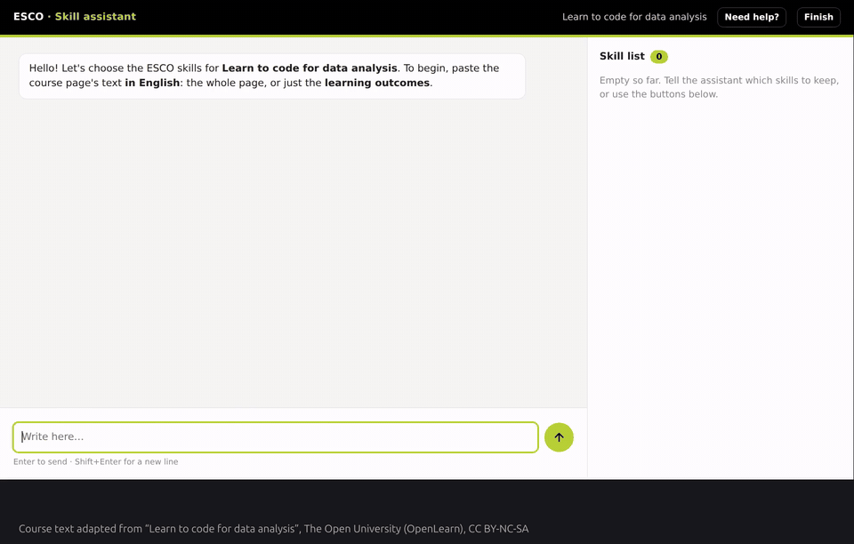
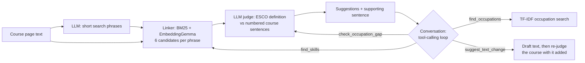

# esco-course-agent

**A chat assistant that helps university teachers describe a course unit with [ESCO](https://esco.ec.europa.eu/) skills, and shows, sentence by sentence, why each skill fits.** The teacher pastes the course page; the assistant suggests ESCO skills, each with the course sentence that supports it; the teacher keeps or removes them in conversation, asks which occupations the course leads to and what it lacks for one, and gets proposed text for the course page, checked before it is shown.

- **Why it needs tools:** asked directly, the same LLM gets the exact ESCO name right for only **19%** of the skills it lists [95% CI 9–29%] and never gives an ESCO identifier. With tools, every suggestion is a real ESCO entry with a sentence from the text, and, labelled by the author with a fixed rule, **87%** of the judge's suggestions are fully right and 4 of 93 wrong; two LLM raters, as checks, give 79–84% fully right.
- **Stack:** LangGraph agent with function calling (DeepSeek), an MCP server over a hybrid BM25 + EmbeddingGemma skill linker, FastAPI with streamed replies, Docker.
- **Status:** deployed inside the University of Aveiro's course platform (POF), piloted and approved by the project supervisor; a study with teachers runs on 1 December 2026.



**Full walkthrough (79 s):** paste a course page → skills with evidence → remove one with a reason → occupations → what the course lacks → text for a missing skill, checked → accepted and re-checked.

https://github.com/user-attachments/assets/dc1ecad3-1e18-44ac-8fa8-61d1009acca3

## How it works



- **First answer is fixed, not agentic:** an LLM turns the course into short search phrases; the linker returns candidates for each; a judge reads each candidate's ESCO definition against the numbered course sentences and keeps only those it can cite a sentence for. A validator rejects answers that skip, repeat or invent skills or sentence numbers, with one retry.
- **Follow-ups are a tool-calling loop** (LangGraph) over: update the list, search for more skills, rank occupations, check an occupation's gap, draft a text change, decide on a text change. ESCO data is served by an MCP server (`link_text`, `search_occupations`, `get_occupation_skills`).
- **Text changes are verified:** a draft is added to its section and the judge runs again; it only counts if the judge now finds the skill and cites the new text. Failed drafts are explained ("what the course would need to cover"), not offered.
- **Grounding:** skills only from tool results, evidence only from the course text; every reply is checked for quotes not found in the text or tool results and for skill numbers that don't exist, and flagged to the teacher.

## Results

All numbers from `docs/findings.md`; raw outputs under `results/`.

| What | Result | How |
|---|---|---|
| **Occupation search** (half of an occupation's essential skills as the query) | rank 1: **0.942** [0.933, 0.949]; top 10: 0.987. Simpler scorers: overlap 0.780, coverage 0.744 | 3,038 ESCO occupations, 95% bootstrap CI; `python -m esco_core.smoke_occupations` |
| **No-tools baseline** (same LLM, asked directly) | exact ESCO label **0.190** [0.088, 0.291]; any ESCO label 0.206; URI given 0.000; sentence really in the text 0.948 | 6 real course pages × 3 runs, 248 items; `python -m esco_agent.baseline` |
| **Judge evidence precision** | strict **0.871** [0.793, 0.934]; lenient (incl. partly supported) **0.957** [0.907, 0.991]; wrong 4/93 | all 93 first-turn suggestions on 6 courses, labelled by the author with a fixed rule (95% bootstrap over courses); two LLM raters as checks: Gemini strict 0.839, Claude 0.785; agreement with the author 0.84 / 0.81 (AC1 0.82 / 0.77; κ 0.37 / 0.35, low because ~85% of rows are right), no right-vs-wrong disagreement |
| **vs the European Commission's ESCO mapping tool** (Open Access Mapping 1.3.0, Top K 15) | Retrievers on single lines, strict P@3 tool minus linker **+0.03 to +0.12** across both raters and with the tool's 22 non-ESCO names counted wrong or not: clear for both raters as labelled (+0.06 [+0.02, +0.10], +0.12 [+0.07, +0.16]); with the non-ESCO names counted wrong, clear for one rater (+0.06 [+0.02, +0.11]) but not the other (+0.03 [−0.01, +0.07]). At rank 1 the difference depends on the rater (+0.03 [−0.04, +0.11] to +0.11 [+0.02, +0.19]). Neither retriever is precise alone: 32–46% of rank-1 and 18–32% of top-3 candidates fully right. The agent's first list (filtered by an LLM judge, with cited sentences) is a different measurement: 79–84% fully right on its own sheet by the two LLMs (87% by the author), 72–76% when judged against single lines. Reviews per fully right skill: agent **1.2–1.3** vs the tool's 2.9 (K=1) to 6.4 (K=3), about 2–5× fewer. Relative recall of the agent against the tool's top 3: **0.73–0.90** (an upper bound: the tool's ranks 4–15 were not labelled) | the tool's 123 non-noise lines of 6 courses, top 3 of each retriever, 608 rows labelled blind by two LLMs (Gemini, Claude; agreement 0.78, κ 0.65), no human labels; 95% paired bootstrap over lines; `python -m esco_agent.compare_tool` |
| **Candidates per search phrase** 4 → 6 | e.g. "operating systems" now reaches the judge for a C course; adopted as the default | 7 courses × 3 runs; `python -m esco_agent.suggest --per-query-k` |

The labelling rule: for knowledge items, *right* if the cited sentence names or covers the topic; for activities, *right* only if students are shown doing it, *borderline* if only the topic is named; *wrong* if the words match in a different sense.

**Not evaluated:** the planned ~25 multi-turn conversations scoring tool choice, and an LLM judge of occupation correctness validated on human labels. Tool use is covered by unit tests with scripted LLMs and by real sessions read by hand, not by a measured rate.

## Limitations

- The linker was benchmarked on occupation descriptions, never on course text. Short or framed sentences ("become autonomous in the use of Linux") can rank the right skill low; 6 candidates per phrase was chosen on 7 courses.
- The judge sometimes accepts a skill on shared words despite its definition (2/93), and decides borderline candidates differently between runs.
- ESCO has gaps for course content: no skill for using Linux or the C language; programming languages and operating systems are folded into broad entries.
- English course text only (the linker retrieves better in English); the conversation is Portuguese or English.
- The smoke test uses exact ESCO skills of the target occupation, so it checks the ranking, not the occupations a real course gets.

## Run locally

Python 3.10+, a DeepSeek API key, and a Hugging Face read token for an account that has accepted the [EmbeddingGemma](https://huggingface.co/google/embeddinggemma-300m) licence.

```bash
python -m venv .venv && source .venv/bin/activate
pip install -r requirements.txt   # plus torch for your machine
pip install -e .
cp .env.example .env              # set DEEPSEEK_API_KEY and HF_TOKEN; remove ESCO_AUTH=pof

python -m esco_agent.web          # web assistant on http://localhost:8000 (no login: type any email)
python -m esco_agent.suggest --course course.json --repeat 3   # suggestions only, with stability
```

**Data:** `data/` is not in the repo. It holds ESCO v1.2.1 as parquet files and the precomputed skill embeddings, built by the ingest step of the skill-linker project: `skills`, `texts`, `labels`, `occupations`, `occupation_skill_relations` `.parquet` + `embeddinggemma_en_labels_desc_e4d6efad9018.npy`. ESCO is published by the European Commission and free to reuse.

**Course files** are JSON: `{"Learning outcomes": "...", "Contents": "..."}`.

**Deployment** behind another platform's login: `deploy/DEPLOY.md` (Docker, nginx).

## Repository

- `src/esco_core/`: skill linker (hybrid BM25 + EmbeddingGemma, ported from the linker project and checked for identical rankings), occupation search, smoke test.
- `src/esco_mcp/`: MCP server over the ESCO data.
- `src/esco_agent/`: the assistant (`assistant.py`, LangGraph), suggestion pipeline and judge (`suggest.py`, `coverage.py`), grounding check, baseline and labelling scripts, and the web app (`web/`).
- `tests/`: 78 tests; those needing `data/` are skipped without it. `pytest -q`.
- `docs/findings.md`: dated findings, decisions and every number above.
